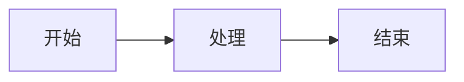

# 主题配色对照样例

一屏之内放齐「自己会带底色」的那几块：mermaid 图、Shiki 代码块、内联公式 $E = mc^2$。
换主题时它们必须一起翻——图是渲染那一刻定色，代码是 `--shiki-light/dark` 两套色。



```ts
interface Point { x: number; y: number }
function midpoint(a: Point, b: Point): Point {
  return { x: (a.x + b.x) / 2, y: (a.y + b.y) / 2 };
}
```

```json
{
  "name": "LitePad",
  "themes": ["light", "dark"]
}
```

```
没有语言标注的围栏：走纯文本，不该被高亮
```

## 表格与引用

| 语法 | 渲染器 | 配色怎么跟主题 |
| --- | --- | --- |
| 代码块 | Shiki | CSS 变量 `--shiki-light/dark` |
| 图 | Mermaid | 渲染那一刻定色，切主题要重画 |

> 引用块：底色与左边线也应随主题翻。
