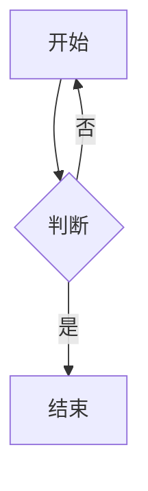

# 预览排版与配色样例

首屏定位用的短正文：下面那块图是「不许闪」的对照。



## 一、标题与段落节奏

正文段落之间应有一条明显的空白边界。这一段刻意写得长一些，用来看**行距**（设置里的「预览行距」）与**段间距**是不是各管各的：行内不该被拉开，段与段之间才该。

第二段，带**粗体**、*斜体*、~~删除线~~、`内联代码`、[链接](https://example.com) 与自动链接 https://tauri.app。

### 三级标题

#### 四级标题

##### 五级标题

###### 六级标题

## 二、列表

- 无序项甲
- 无序项乙
  - 嵌套一层
  - 嵌套的第二个子项
- 无序项丙

1. 有序一项
2. 有序二项
3. 有序三项

- [x] 已完成的任务项（预览里点它不会回写源码）
- [ ] 未完成的任务项

## 三、引用与分隔线

> 一层引用。
>
> 引用里的第二段。
>
> > 嵌套引用。

---

## 四、代码块（Shiki 双主题）

```ts
interface Point {
  x: number;
  y: number;
}
function midpoint(a: Point, b: Point): Point {
  return { x: (a.x + b.x) / 2, y: (a.y + b.y) / 2 };
}
```

```json
{
  "name": "LitePad",
  "themes": ["light", "dark"]
}
```

```
没有语言标注的围栏：走纯文本，不该被高亮
```

## 五、表格

| 语法 | 渲染器 | 配色怎么跟主题 |
| --- | --- | --- |
| 代码块 | Shiki | CSS 变量 `--shiki-light/dark` |
| 公式 | KaTeX | `currentColor` |
| 图 | Mermaid | 渲染那一刻定色，切主题要重画 |
| 正文 | 自己 | `--md-fg` 等一组变量 |

## 六、公式（KaTeX）

行内公式 $E = mc^2$ 与块级公式：

$$\int_{-\infty}^{\infty} e^{-x^2}\,dx = \sqrt{\pi}$$

## 七、脚注

这里放一个脚注引用[^1]。

[^1]: 脚注正文，会渲染到文档末尾的脚注区。
